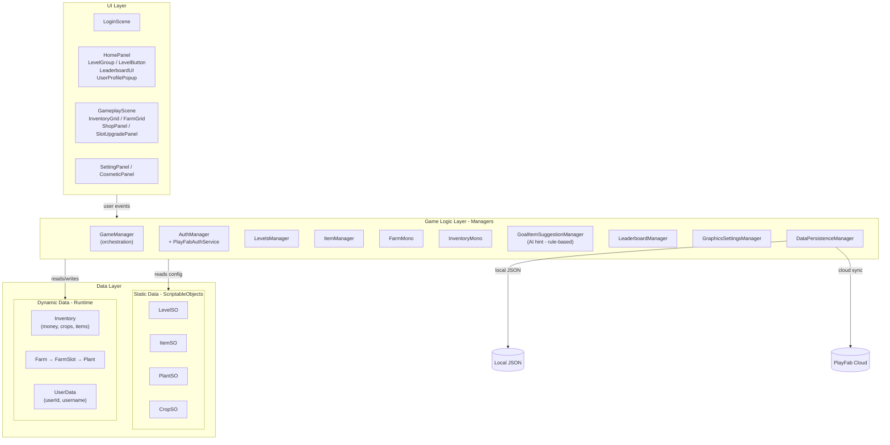
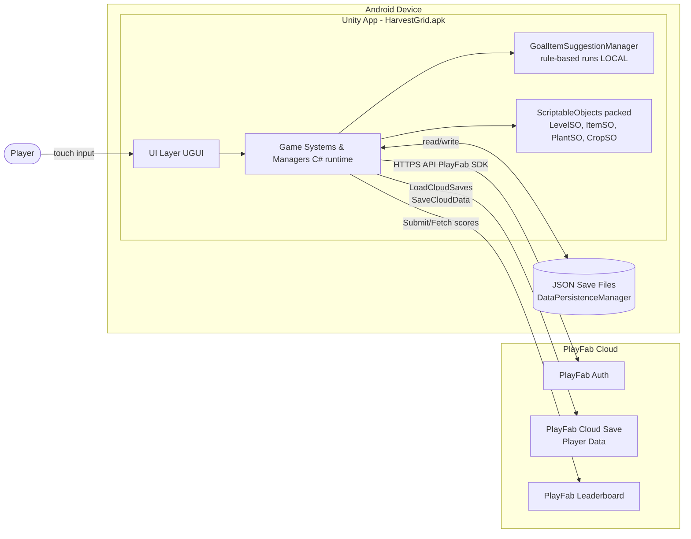
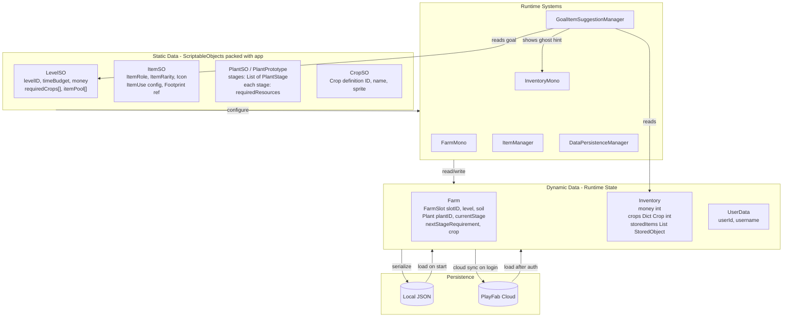
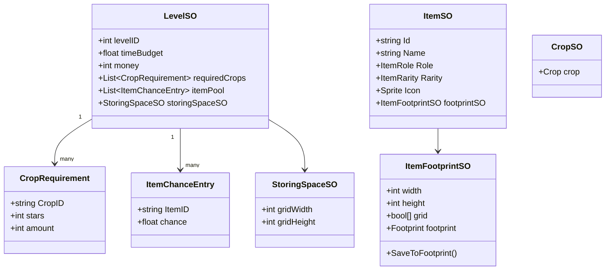
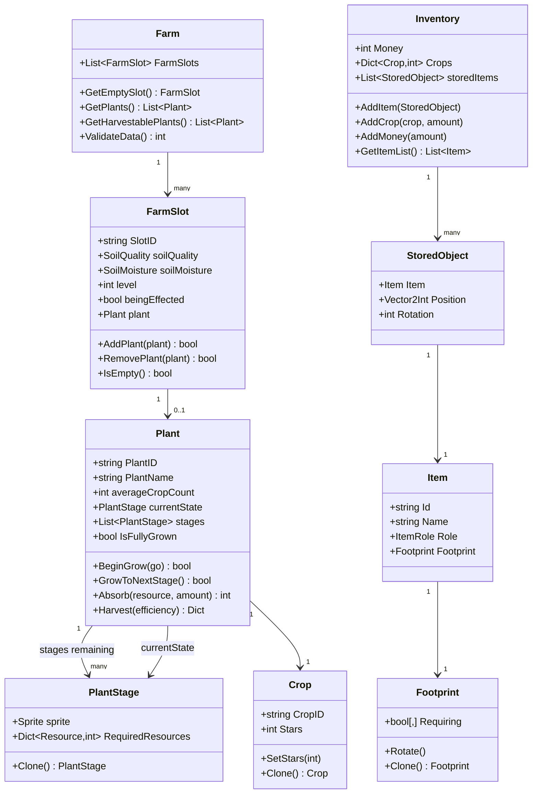
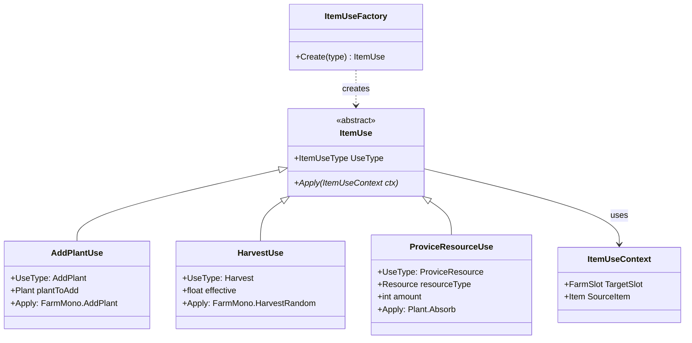
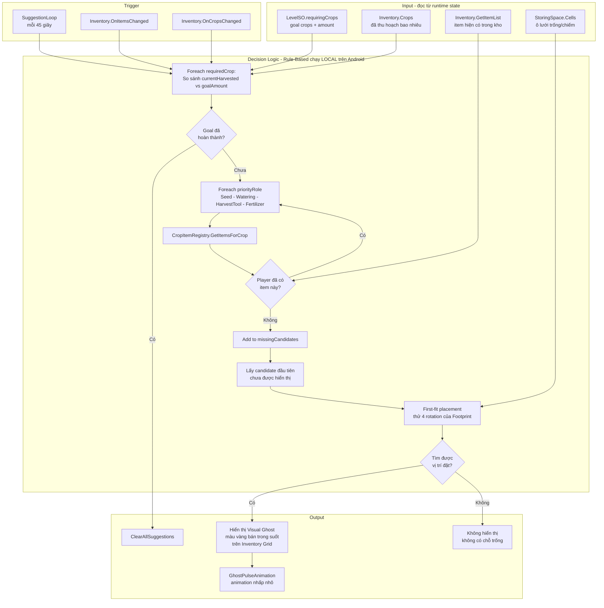
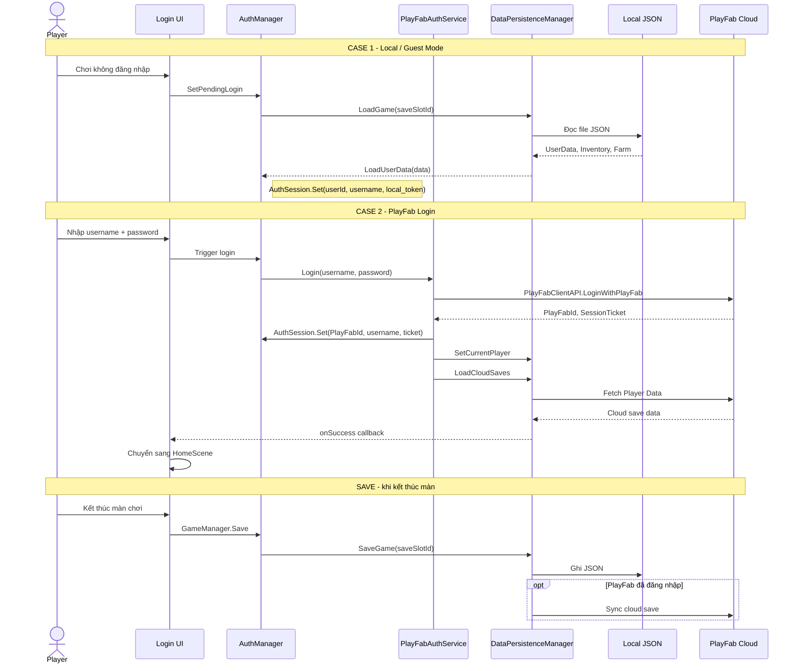

# SƠ ĐỒ HARVEST GRID – V7

> Tất cả sơ đồ dưới đây được tạo từ source code thực tế.  
> Tên class/component khớp với codebase.

---

## Diagram 1 – Use Case Tổng Thể

```mermaid
flowchart LR
    Player(["👤 Player"])
    System(["⚙️ System\n(Auto)"])

    subgraph UC["Harvest Grid – Use Cases"]
        direction TB

        subgraph AUTH["Xác thực"]
            UC1["Đăng ký / Đăng nhập\n(PlayFab)"]
            UC2["Chơi không cần đăng nhập\n(Local/Guest)"]
            UC3["Đăng xuất"]
        end

        subgraph HOME["Màn hình chính"]
            UC4["Xem danh sách màn chơi"]
            UC5["Chọn màn chơi"]
            UC6["Xem Profile người chơi"]
            UC7["Xem bảng xếp hạng\n(Leaderboard)"]
            UC8["Cài đặt\n(Graphics/Sound)"]
        end

        subgraph GAMEPLAY["Gameplay"]
            UC9["Xem Farm Grid\n(trạng thái cây trồng)"]
            UC10["Dùng Seed item\n→ Trồng cây (AddPlantUse)"]
            UC11["Dùng Tool item\n→ Thu hoạch (HarvestUse)"]
            UC12["Dùng Buff item\n→ Cung cấp Resource (ProviceResourceUse)"]
            UC13["Xem và quản lý\nInventory Grid"]
            UC14["Xem mục tiêu màn chơi"]
            UC15["Thắng / Thua màn chơi"]
        end

        subgraph SHOP["Shop"]
            UC16["Xem vật phẩm trong Shop"]
            UC17["Mua vật phẩm"]
        end

        subgraph FARM_MGMT["Quản lý Nông trại"]
            UC18["Xem trạng thái Farm Slot"]
            UC19["Nâng cấp Farm Slot\n(SlotUpgradePanel)"]
        end

        subgraph SYSTEM_AUTO["Hệ thống Tự động"]
            UC20["Sinh trưởng cây theo Resource\n(Plant.Absorb → GrowToNextStage)"]
            UC21["Gợi ý vật phẩm cần mua\n(GoalItemSuggestionManager)"]
            UC22["Lưu / Tải dữ liệu\n(DataPersistenceManager)"]
        end
    end

    Player --> UC1
    Player --> UC2
    Player --> UC3
    Player --> UC4
    Player --> UC5
    Player --> UC6
    Player --> UC7
    Player --> UC8
    Player --> UC9
    Player --> UC10
    Player --> UC11
    Player --> UC12
    Player --> UC13
    Player --> UC14
    Player --> UC15
    Player --> UC16
    Player --> UC17
    Player --> UC18
    Player --> UC19

    System --> UC20
    System --> UC21
    System --> UC22
```

---

## Diagram 2 – Logical / System Architecture

---

## Diagram 3 – Physical / Deployment Architecture

> **Lưu ý quan trọng:** Toàn bộ game logic, AI inference và rendering chạy trên Android device. PlayFab chỉ phục vụ xác thực, lưu cloud và bảng xếp hạng.

---

## Diagram 4 – Data Architecture Overview

---

## Diagram 5 – ScriptableObject Model

---

## Diagram 6 – Entity / Data Class Diagram

---

## Diagram 7 – Item Use System

---

## Diagram 8 – Auto-Farming / Plant Growth Activity

```mermaid
flowchart TD
    Start(["Player chọn Seed item"])
    UseItem["Player kích hoạt Item Use\ntap seed → tap FarmSlot"]
    AddPlant["AddPlantUse.Apply\nFarmMono.AddPlant(plant, slot)"]
    BeginGrow["Plant.BeginGrow\nGrowToNextStage Stage 0 to 1"]
    ShowPlant["PlantMono.UpdateSprite\nHiển thị cây stage 1"]

    CheckReq{{"Plant cần Resource\n(nextStageRequirement)?"}}

    UseBuffItem["Player dùng Buff Item\nWaterCan/Fertilizer/GrowthBuff"]
    ProvideRes["ProviceResourceUse.Apply\nPlant.Absorb(resource, amount)"]
    FulfillReq{"nextStageRequirement\nđã thỏa đủ?"}
    GrowStage["Plant.GrowToNextStage\ncurrentState = stages.RemoveFirst\nTrigger OnStageChanged"]
    UpdateUI["PlantMono.UpdateSprite\nPlantMono.UpdateRequiringPanel"]

    FullyGrown{"Plant.IsFullyGrown?\nstages.Count == 0"}

    UseHarvest["Player dùng Harvest Tool\nScythe / LongScythe"]
    Harvest["HarvestUse.Apply(effective)\nPlant.Harvest(efficiency)"]
    CalcYield["totalYield = averageCropCount x efficiency\nbaseStar = Clamp(Floor(eff x 2), 1, 5)"]
    AddCrops["Inventory.AddCrop\nTrigger OnCropsChanged"]
    ClearSlot["FarmSlot.RemovePlant\nSlot trống sẵn sàng dùng lại"]
    WinCheck{"Tất cả requiredCrops\nđã đủ?"}
    Win(["GameplayScene.Win"])
    Continue(["Tiếp tục gameplay"])

    Start --> UseItem
    UseItem --> AddPlant
    AddPlant --> BeginGrow
    BeginGrow --> ShowPlant
    ShowPlant --> CheckReq

    CheckReq -->|Có| UseBuffItem
    CheckReq -->|Không - fully grown| FullyGrown

    UseBuffItem --> ProvideRes
    ProvideRes --> FulfillReq
    FulfillReq -->|Chưa đủ| CheckReq
    FulfillReq -->|Đủ| GrowStage
    GrowStage --> UpdateUI
    UpdateUI --> FullyGrown

    FullyGrown -->|Chưa| CheckReq
    FullyGrown -->|Có| UseHarvest
    UseHarvest --> Harvest
    Harvest --> CalcYield
    CalcYield --> AddCrops
    AddCrops --> ClearSlot
    ClearSlot --> WinCheck
    WinCheck -->|Chưa đủ| Continue
    WinCheck -->|Đủ| Win
```

---

## Diagram 9 – AI Goal Item Suggestion Pipeline

> ⚠️ **Lưu ý:** Đây là **rule-based decision system**, KHÔNG phải machine learning. Không có training, model weights hay dữ liệu lịch sử người chơi được dùng để cập nhật logic.

---

## Diagram 10 – Login / Save / Load Sequence

---

## Bảng đối chiếu: Use Case ↔ Manager ↔ UI Screen ↔ Data

| Use Case | Manager / System | UI Screen | Static Data | Dynamic Data |
|----------|-----------------|-----------|------------|-------------|
| Đăng nhập PlayFab | `AuthManager`, `PlayFabAuthService` | `LoginScene` | — | `UserData` |
| Chơi Guest | `AuthManager`, `LocalAuthService` | `LoginScene` | — | `UserData` local |
| Xem màn chơi | `LevelsManager` | `HomePanel > LevelGroup` | `LevelSO[]` | Level unlock state |
| Trồng cây | `FarmMono`, `InventoryMono` | `GameplayScene` | `PlantSO`, `ItemSO` | `Farm`, `Inventory` |
| Thu hoạch | `FarmMono`, `InventoryMono` | `GameplayScene` | `ItemSO (HarvestTool)` | `Farm`, `Inventory.crops` |
| Dùng Buff item | `FarmMono`, `InventoryMono` | `GameplayScene` | `ItemSO (Buff)` | `Plant.nextStageRequirement` |
| Quản lý Inventory | `InventoryMono` | `GameplayScene > InventoryGrid` | `ItemFootprintSO` | `Inventory.storedItems` |
| Mua vật phẩm | `ItemManager` | `ShopPanel` | `LevelSO.itemPool` | `Inventory.money` |
| Nâng cấp Farm Slot | — (cần xác minh) | `SlotUpgradePanel` | — | `FarmSlot.level` |
| AI Gợi ý vật phẩm | `GoalItemSuggestionManager` | Overlay trên `InventoryGrid` | `LevelSO.requiredCrops` | `Inventory`, `StoringSpace.Cells` |
| Cài đặt | `GraphicsSettingsManager` | `SettingPanel` | — | Settings state |
| Xem Profile | `UserManager` | `UserProfilePopup` | — | `UserData` |
| Xem Leaderboard | `LeaderboardManager` | `LeaderboardUI` | — | PlayFab Leaderboard |
| Lưu / Tải | `DataPersistenceManager` | — background | — | Tất cả dynamic data |
